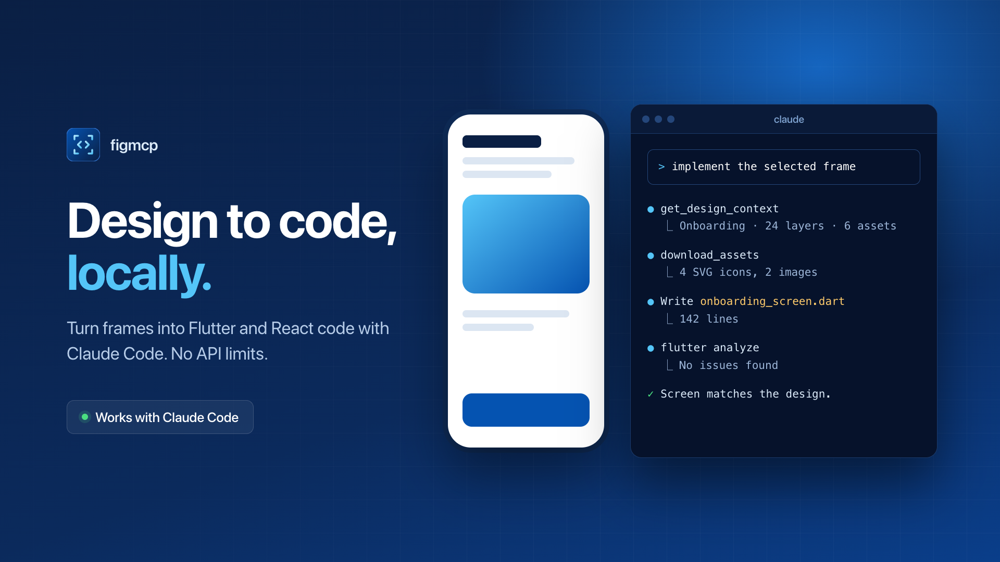

<div align="center">

<a href="https://figmcp.web.app"></a>

<h1>
<picture>
  <source media="(prefers-color-scheme: dark)" srcset="https://raw.githubusercontent.com/irshadio/figmcp/main/.github/assets/wordmark-dark.svg">
  
</picture>
</h1>

<p><strong>Design and code, locally.</strong><br>
Turn Figma frames into Flutter and React code, and let your coding agent design in Figma.<br>
No Figma API calls. No rate limits.</p>

<p>
<a href="https://www.npmjs.com/package/@irshad.io/figma-local-mcp"></a>


</p>

<p>
<a href="https://glama.ai/mcp/servers/irshadio/figmcp"></a>
</p>

<p>
<a href="https://figmcp.web.app">Website</a> ·
<a href="https://figmcp.web.app/docs">Docs</a> ·
<a href="https://figmcp.web.app/docs/installation">Installation</a> ·
<a href="https://figmcp.web.app/docs/tools">Tools</a> ·
<a href="https://figmcp.web.app/docs/changelog">Changelog</a>
</p>

</div>

---

figmcp is a local MCP server that gives your coding agent the Figma file you have open in Figma Desktop. A development plugin streams the file to a server on your machine over localhost, so reads never touch the Figma REST API: no access token, no quota, no rate limit.

- **Design to code.** Flutter widgets for Flutter projects, React + Tailwind for everything else, with the assets and a screenshot to compare against.
- **Design in Figma.** The agent creates and edits frames in the open file with Figma plugin API scripts, one undo step per script.
- **Your components.** Map design components to code components with Code Connect.
- **Works offline.** Read saved snapshots when the plugin is closed.
- **Any plan.** Works on every Figma plan, including the free Starter plan. No Dev Mode seat needed.

Works with Claude Code, Cursor, Claude Desktop and any MCP client that runs stdio servers.

## Quick start

Needs **Node.js 18+** and **Figma Desktop** on macOS or Windows.

**1. Run setup**

```bash
npx -y @irshad.io/figma-local-mcp@latest setup
```

It registers the server with Claude Code, copies the Figma plugin to your home folder, and prints your pairing code and the config for other MCP clients.

**2. Import the plugin (once)**

In Figma Desktop, go to **Plugins › Development › Import plugin from manifest…** and choose:

| macOS | Windows |
| --- | --- |
| `~/.figma-local-mcp/plugin/manifest.json` | `%USERPROFILE%\.figma-local-mcp\plugin\manifest.json` |

On macOS, press <kbd>⌘</kbd> <kbd>⇧</kbd> <kbd>G</kbd> in the file picker and paste the path. On Windows, paste it into the **File name** box.

**3. Pair and ask**

Restart your coding agent. In Figma Desktop, run **Plugins › Development › figmcp** and enter the pairing code. The dot turns green once it's connected. Then select a frame and ask:

```
implement the selected Figma frame
```

Keep the plugin window open while you work. Full guide: [figmcp.web.app/docs/installation](https://figmcp.web.app/docs/installation).

## Usage

### Design to code

Select a frame, or paste a Figma link that has a `node-id`:

```
implement this frame as a Flutter screen and match the spacing exactly
build this frame as a React component with Tailwind, using our existing Button
compare your screen with the Figma screenshot and fix the differences
```

Projects with a `pubspec.yaml` get **Flutter** widgets, and SVGs and images are saved into the asset folders the pubspec declares. Everything else gets **React + Tailwind**. React output uses the real font families, declares the design's variables as CSS (with a Tailwind 4 `@theme`), names assets after their layers with copy commands for `public/figma`, turns prototype taps and layer names into buttons, links and landmarks, and draws phone frames as screens that fill the viewport. Its classes work in Tailwind 3.4 and 4. The code is a reference that your agent adapts to your project. [More →](https://figmcp.web.app/docs/design-to-code)

### Design in Figma

Open the file in Figma Desktop, run the plugin and ask:

```
design a settings screen for a 390x844 phone in Figma
add a dark mode version of the selected frame next to it
```

The agent builds the design with `use_figma` and checks each step with a screenshot. Each script is one undo step. [More →](https://figmcp.web.app/docs/design-in-figma)

### Code Connect

```
map the selected button to AppButton in lib/widgets/app_button.dart
which components in this frame are not mapped yet?
```

Mapped instances come back as your own components. Mappings are saved in `.figma-local/code-connect.json` in your project. [More →](https://figmcp.web.app/docs/code-connect)

## MCP clients

**Claude Code** is registered by setup. Restart it and check with `/mcp`.

**Cursor, Claude Desktop and other clients:** add the config that setup prints. It looks like this, with paths for your machine:

```json
{
  "mcpServers": {
    "figma-local": {
      "command": "/usr/local/bin/node",
      "args": ["/Users/you/.figma-local-mcp/app/node_modules/@irshad.io/figma-local-mcp/bin/figma-local-mcp.js"]
    }
  }
}
```

| Client | Config file |
| --- | --- |
| Cursor | `~/.cursor/mcp.json` (all projects) or `.cursor/mcp.json` (one project) |
| Claude Desktop (macOS) | `~/Library/Application Support/Claude/claude_desktop_config.json` |
| Claude Desktop (Windows) | `%APPDATA%\Claude\claude_desktop_config.json` |

Step-by-step for each client, on macOS and Windows: [figmcp.web.app/docs/configuration](https://figmcp.web.app/docs/configuration).

## Tools

| Tool | What it does |
| --- | --- |
| `get_design_context` | Reference code (Flutter or React + Tailwind), assets, a screenshot and variables for a node. The main tool. |
| `get_metadata` | Layer tree as XML: ids, types, names, positions and sizes. |
| `get_screenshot` | PNG of a node or the selection. |
| `get_variable_defs` | Variables and styles used by a node, resolved for its mode. |
| `download_assets` | Exported renders, original image fills and vector SVGs. |
| `verify_code` | Render Flutter code with `flutter test`, or React + Tailwind in headless Chrome, and compare it with Figma's render: errors, layout mismatches, differing pixels and a diff image. |
| `use_figma` | Run Figma plugin API scripts to create and edit designs. |
| `search_design_system` | Components (with properties and variants), styles and variables of the open file, to reuse while designing. |
| `place_image` | Put a local PNG, JPG, GIF or SVG into the open file, as a new layer or a layer's fill. |
| `get_code_connect_map` | Which instances map to which code components. |
| `add_code_connect_map` | Map a design component to a code component. |
| `remove_code_connect_map` | Remove a component mapping. |
| `whoami` | Connection status, pairing code, open file, selection and snapshots. |
| `save_design_export` | Write a full design export of a node to JSON. |
| `import_design_export` | Load an export JSON as a snapshot. |

Arguments for each tool: [figmcp.web.app/docs/tools](https://figmcp.web.app/docs/tools).

## How it works

```
Figma Desktop  ── WebSocket 127.0.0.1:3947 ──▶  figma-local-mcp  ── MCP stdio ──▶  Coding agent
(dev plugin)       paired with your code        (node server)                     (Claude Code, Cursor, …)
```

The plugin reads the open file with the Figma plugin API and runs the scripts your agent sends. The server turns that into code, assets, screenshots and metadata. When the plugin is closed, reads fall back to the newest saved snapshot. [More →](https://figmcp.web.app/docs/how-it-works)

## Configuration

Set these in the `env` of your MCP client config.

| Variable | Default | Description |
| --- | --- | --- |
| `FIGMA_LOCAL_MCP_DIR` | `~/.figma-local-mcp` | Data folder: plugin, pairing code, snapshots and assets. |
| `FIGMA_LOCAL_MCP_FRAMEWORK` | | Force `flutter` or `react` when the client doesn't say. |
| `FIGMA_LOCAL_MCP_CODE_CONNECT` | `.figma-local/code-connect.json` | Path of the Code Connect mappings file. |
| `FIGMA_LOCAL_MCP_ALLOW_ORIGINS` | | Comma separated extra origins the server accepts for the plugin. |

## Update

```bash
npx -y @irshad.io/figma-local-mcp@latest setup
```

Then restart your coding agent and run the plugin again. The plugin updates itself, so there's no need to import it again.

## Troubleshooting

- **The dot stays grey:** start your coding agent first, then run the plugin again.
- **Lost the pairing code:** run setup again, or ask your agent to run `whoami`.
- **`use_figma` can't edit the file:** switch the file from Dev Mode back to Design mode.

More fixes: [figmcp.web.app/docs/troubleshooting](https://figmcp.web.app/docs/troubleshooting). Still stuck? [Open an issue](https://github.com/irshadio/figmcp/issues) with the output of `whoami`.

## Development

```bash
npm install
npm test
```

| Path | What |
| --- | --- |
| `bin/`, `src/` | The MCP server, plugin bridge and code generators |
| `plugin/` | The Figma development plugin |
| `tools/` | Visual and Flutter checks for generated code |
| `test/` | Tests (`node --test`) |
| `web/` | The website and docs ([figmcp.web.app](https://figmcp.web.app)), Next.js on Firebase Hosting |

To work on the site: `cd web && npm install && npm run dev`. To publish it: `npm run deploy`.

## License

[MIT](LICENSE)

<sub>Figma is a trademark of Figma, Inc. This project is not affiliated with Figma, Inc.</sub>
